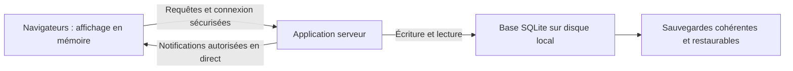

**TimeTeknika — étude de Toggl et stratégie proposée pour la V1**

Document de travail du 28 octobre 2026. Statut : proposition à affiner avant développement.

Je recommande une application centrée sur trois parcours : enregistrer son temps, retrouver les tâches partagées et leurs participants, puis consulter des récapitulatifs fiables. L’expérience de référence est le nouveau Toggl, accessible sur focus.toggl.com. La collaboration, la conservation des données et la synchronisation doivent faire partie du premier prototype.

L’étude couvre les textes des 122 articles du centre d’aide référencés dans son plan officiel, ses pages de navigation, ainsi qu’une consultation ciblée de l’API Focus. L’[inventaire des sources](./TOGGL_SOURCES.md) donne les liens, la portée et les limites de cette recherche. Les parcours dans votre compte n’ont pas été testés : la session de navigateur accessible aboutit à la connexion. Les constats ci-dessous sont donc documentaires ; ils ne constituent pas une validation visuelle ou un test pratique de votre interface.

**Ce que vous avez déjà décidé.**

| Sujet | Décision confirmée |
|---|---|
| Équipe | 6 à 7 personnes |
| Démarrage | Prototype sur un seul ordinateur |
| Hébergement cible | Docker sur le serveur du bureau |
| Accès extérieur | Tunnel Cloudflare ou VPN de l’entreprise |
| Stockage | Données métier dans un fichier local au serveur, puis sur le serveur du bureau ; aucune persistance métier dans le navigateur |
| Connexion | Cookie technique de session accepté |
| Collaboration | Tous les employés créent clients, projets et tâches ; affectations à plusieurs personnes |
| Saisie | Chaque personne enregistre son propre temps sur la même tâche |
| Entrée de temps | Description, tâche, projet et client disponibles pour le suivi et les rapports |
| Démarrage rapide | Autorisé sans tâche ; rubrique « À classer » et rappel |
| Consultation | Chacun voit ses entrées ; seuls les responsables voient le détail des autres |
| Correction | L’auteur uniquement peut modifier ses entrées |
| Actualisation | Automatique entre les utilisateurs, les appareils et les vues, selon leurs droits |
| Priorité | Fiabilité du chrono, correction des entrées et tâches partagées |
| Excel | Dans un second temps |

Les propositions qui suivent ne sont pas encore des fonctionnalités réalisées. Le caractère obligatoire de la description, la politique précise des rappels et les futures règles de congés restent à affiner.

**Ce que Toggl fait déjà bien et que nous devons conserver.**

Le nouveau Toggl rapproche suivi du temps et organisation du travail. Son chrono permet de choisir une tâche ou un projet, de saisir un descriptif, d’ajouter du temps après coup et de continuer une activité précédente. Ses vues calendrier, historique et feuille de temps montrent les mêmes données sous différentes formes. Le choix d’une tâche renseigne son projet ; la recherche du sélecteur prend en compte tâches, projets et clients. Ce fonctionnement réduit les ressaisies et doit guider notre écran principal. Sources : [suivi du temps](https://docs.toggl.com/time-tracking-in-toggl-2-0), [page Timer](https://docs.toggl.com/overview-of-the-timer-page), [mode manuel](https://docs.toggl.com/manual-mode).

Toggl possède déjà les tâches avec plusieurs personnes affectées. Il distingue l’estimation de travail de chaque participant des temps réellement enregistrés. Les tâches sont des objets partagés : elles ne se confondent pas avec les descriptions individuelles des entrées. Sources : [tâches](https://docs.toggl.com/tasks-in-toggl-2-0), [organisation des données](https://docs.toggl.com/the-new-toggl-data-organization-guide).

Les rapports distinguent une synthèse regroupée et une liste détaillée des entrées. Les filtres comprennent notamment période, membre, client, projet, tâche et description. Cette séparation convient exactement à vos besoins : comprendre les cumuls, puis retrouver les lignes qui les expliquent. Sources : [rapports](https://docs.toggl.com/overview-of-the-reports-page), [synthèse](https://docs.toggl.com/summary-report-in-toggl), [entrées détaillées](https://docs.toggl.com/time-logs-report-in-toggl-2-0).

Toggl a aussi une offre beaucoup plus large : planification, capacité, rentabilité, validations, congés, applications natives, intégrations et assistant IA. Nous avons étudié ces fonctions pour préparer les évolutions ; les reproduire toutes rendrait la première version disproportionnée pour votre besoin immédiat. Le [comparatif officiel des offres](https://docs.toggl.com/toggl-plans-whats-included) situe ces fonctions, avec quelques divergences documentaires relevées dans l’inventaire.

**Pourquoi développer votre outil.**

Le partage des tâches et les rapports par personne ne sont pas des fonctionnalités absentes de Toggl. L’intérêt de votre application est leur combinaison avec l’hébergement chez vous, l’absence de persistance métier dans le navigateur, des droits très précis et, ensuite, vos modèles Excel. Pour 6 à 7 utilisateurs, économiser un abonnement ne suffit pas à justifier à lui seul la maintenance d’une application. La décision de construire doit surtout reposer sur ces besoins propres et sur votre capacité à maintenir sauvegardes, mises à jour et disponibilité.

| Fonction | Observation documentaire sur Toggl | Proposition pour vous |
|---|---|---|
| Chrono et saisie manuelle | Plusieurs points d’entrée rapides | V1, même simplicité |
| Tâche à plusieurs personnes | Déjà disponible | V1, un objet commun et des temps individuels |
| Projet et client | Le client est rattaché au projet | V1, remplissage automatique cohérent |
| Description | Texte propre à l’entrée, distinct de la tâche | V1, visible et recherchable |
| Corrections | Certains rôles peuvent intervenir sur les temps d’autrui | Auteur uniquement chez vous |
| Rapports | Synthèse et détail avec filtres | V1, client → projet → tâche → personne |
| Vues et préférences | Certaines sont conservées dans le navigateur | Préférences conservées sur votre serveur |
| Partage de rapports | Peut donner accès aux données avec les droits du propriétaire | Les rapports de la V1 respectent toujours les droits du lecteur |
| Journal d’audit | L’article dédié exclut notamment les changements d’une entrée par son propre auteur | Historique de toutes les corrections, y compris celles de l’auteur |
| Excel et exports | Exports selon vue et format | Phase suivante, adaptés à vos modèles |
| Congés | Saisie personnelle et module de gestion plus complet | Phase ultérieure à définir avec vos règles |

Les différences sur les préférences, les rapports partagés et l’historique proviennent respectivement des articles [vues enregistrées](https://docs.toggl.com/saved-views-in-toggl), [partage des rapports](https://docs.toggl.com/sharing-reports) et [journal d’audit](https://docs.toggl.com/audit-log-in-toggl-2.0). Les possibilités d’intervention des responsables sont notamment décrites dans les [validations de feuilles de temps](https://docs.toggl.com/timesheet-approvals-in-toggl-2.0).

**Le fonctionnement d’une tâche partagée.**

1. Tout employé crée un client, un projet et une tâche, puis choisit les personnes affectées.
2. La tâche apparaît automatiquement dans « Mes tâches » des personnes concernées.
3. Une personne clique sur Démarrer depuis la tâche, ou la choisit dans le chrono.
4. Projet et client se remplissent automatiquement. Elle peut ajouter sa description personnelle.
5. Une autre personne peut travailler au même moment sur cette même tâche avec son propre chrono.
6. Chacune arrête son chrono et peut corriger sa propre entrée.
7. Le responsable voit les contributions individuelles, les cumuls et les corrections dans les écrans autorisés.
8. Les participants gèrent le statut de la tâche commune. Arrêter un chrono ne signifie pas que la tâche est terminée.

Exemple fictif : client Alpha, projet « Étude technique », tâche « Plans d’exécution », affectée à Alice et Bruno.

| Personne | Description de son entrée | Temps terminé |
|---|---|---:|
| Alice | Préparation des plans | 2 h |
| Bruno | Vérification des dimensions | 1 h 30 |
| Total de la tâche | Deux contributions distinctes | 3 h 30 |

Le résultat représente 3 h 30 de travail cumulé, même si les deux personnes ont travaillé en partie simultanément. Le rapport du projet additionne toutes ses tâches ; le rapport du client additionne ses projets. Affecter une troisième personne ne crée aucune entrée et ne multiplie aucun temps.

**Les quatre informations de chaque entrée.**

| Information | Règle proposée |
|---|---|
| Description | Texte personnel de l’entrée ; une modification ne renomme jamais la tâche |
| Tâche | Référence à la tâche commune ; vide autorisé pour démarrer immédiatement |
| Projet | Déduit de la tâche choisie ; un projet peut aussi être choisi en attendant de classer la tâche |
| Client | Déduit du projet ; visible dans la saisie et disponible dans les rapports |

Les champs correspondent à des références fiables, pas à quatre textes indépendants. On ne doit pas pouvoir associer par erreur la tâche d’un projet au client d’un autre. Chez Toggl aussi, un projet a au plus un client et le client d’une entrée se retrouve à travers le projet. Source : [clients](https://docs.toggl.com/clients-in-toggl).

Je recommande que les projets de travail client aient un client renseigné dès leur création, et que les activités internes utilisent un rattachement explicite « Interne ». Cela permet de distinguer le travail interne des entrées encore incomplètes, sans inventer un client commercial.

Une entrée sans tâche reste « À classer », même si elle a déjà une description ou un projet. Proposition de rappel : badge permanent avec le nombre d’entrées concernées, puis rappel personnel en fin de journée, à une heure réglée sur le serveur. Le rappel sera consultable dans l’application ; l’envoi d’emails pourra venir plus tard. L’arrêt du chrono reste toujours possible. Les heures à classer apparaissent dans une ligne dédiée des rapports, sans disparaître des totaux ni être attribuées arbitrairement à un client.

Le choix d’une tâche complète le classement en conservant la description existante. Si le projet préalablement choisi est différent, l’interface montre clairement le changement avant enregistrement. La description reste facultative dans la proposition actuelle, pour conserver le démarrage en un clic ; son éventuelle obligation est un réglage à décider.

**Les droits doivent être identiques dans tous les écrans.**

| Action | Collaborateur | Responsable | Administration technique |
|---|---|---|---|
| Voir les tâches et affectations | Dans ses projets autorisés | Dans son périmètre | Selon rôle métier attribué |
| Créer clients, projets, tâches et affecter plusieurs personnes | Oui, confirmé | Oui | Selon rôle métier attribué |
| Enregistrer et corriger ses temps | Oui | Oui | Oui s’il utilise le suivi |
| Modifier ou supprimer le temps d’un autre | Non | Non | Non dans l’application |
| Voir les entrées d’un autre | Non | Oui dans son périmètre | Seulement avec droit de responsable |
| Voir les récapitulatifs individuels d’équipe | Non | Oui dans son périmètre | Selon rôle métier attribué |
| Créer des comptes dans le prototype | Non | Oui | Selon rôle métier attribué |
| Gérer les réglages techniques du serveur | Non | Pas automatiquement | Oui |

Le rôle de responsable pourra couvrir toute l’équipe ou certains projets. Les noms des personnes affectées et l’état commun de la tâche seront partagés ; le détail de leurs temps ne le sera pas avec les autres collaborateurs. Par défaut, je recommande aussi de réserver les cumuls d’équipe au responsable : sur une tâche à deux personnes, le total permettrait de déduire le temps du collègue.

Ces règles s’appliquent aux réponses du serveur, aux rapports, aux rappels et aux messages de synchronisation. Masquer une colonne dans l’interface ne suffit pas. Changer un identifiant dans une requête ne doit jamais permettre de lire ou de modifier une entrée interdite. L’accès système au serveur reste une capacité distincte des rôles applicatifs ; l’application ne proposera pas de dérogation « administrateur » à la règle de correction par l’auteur.

**Ce qui doit entrer dans la V1.**

| Écran ou module | Contenu proposé |
|---|---|
| Mon temps | Barre de chrono, description, sélecteur recherchant tâche/projet/client, arrêt, reprise, saisie manuelle, totaux jour/semaine |
| Historique et calendrier | Liste par jour et calendrier hebdomadaire simple ; édition rapide des heures et du classement |
| À classer | Entrées sans tâche, accès rapide à leur correction, rappels personnels |
| Mes tâches | Tâches affectées, recherche, projet, client, statut, personnes affectées, bouton Démarrer |
| Projets | Membres, responsables, tâches partagées, affectations et archivage |
| Rapports | Synthèse regroupée et entrées détaillées ; filtres croisés ; choix et tri des colonnes |
| Réglages | Comptes, rôles, fuseau, préférences de vue, sauvegarde et paramètres de connexion |
| Historique des modifications | Auteur, date, valeurs avant/après pour corrections et suppressions logiques |

Les rapports enregistrés et les favoris sont utiles et peu envahissants ; je les placerais après la validation des cumuls et des droits, dans la fin de V1. Ils seront enregistrés sur le serveur, par personne. Les raccourcis clavier doivent fonctionner hors des champs de saisie, sans interrompre la rédaction d’une description.

Je recommande de reporter Excel, exports personnalisés, congés, calendrier de capacité, estimations financières, sous-tâches, projets récurrents, portail client, intégrations externes et IA. Le report des congés est une proposition de périmètre, puisque votre priorité exprimée est le suivi du temps. Une version ultérieure pourra ajouter les estimations de tâche sans transformer les heures consommées en pourcentage d’avancement réel.

**Règles de fiabilité du chrono.**

- Un utilisateur ne peut avoir qu’un chrono actif, même avec plusieurs onglets ou appareils.
- Un changement volontaire de tâche peut arrêter l’entrée courante et démarrer la suivante en une seule opération serveur. Un second appareil agissant sur un état périmé reçoit un conflit explicite, sans écraser silencieusement le travail du premier.
- « Continuer » crée une nouvelle entrée avec les mêmes informations. La pause entre deux sessions n’est pas comptée.
- Le démarrage et l’arrêt sont confirmés seulement après enregistrement serveur. Un double clic ou une nouvelle tentative après délai réseau ne crée pas de doublon.
- Le chrono actif repose sur une heure de début enregistrée. Fermer le navigateur n’arrête pas le chrono ; rouvrir une page retrouve son état. L’affichage avance sans écrire chaque seconde dans la base.
- Un redémarrage du service retrouve le chrono enregistré ; une coupure ne permet pas de deviner une heure d’arrêt que le serveur n’a jamais reçue.
- Saisies manuelles et corrections acceptent date, début, fin et durée avec une règle explicite : début + durée calcule la fin ; début + fin calcule la durée. Une durée négative est refusée.
- Les chevauchements entre deux entrées d’un même utilisateur sont signalés et doivent être confirmés ou corrigés. Le travail simultané de personnes différentes est normal.
- Les entrées très courtes ne sont pas supprimées silencieusement.
- Les corrections concurrentes portent un numéro de version. En cas de conflit, on conserve le texte saisi en mémoire et propose de recharger ou comparer les changements.

**Des rapports dont on peut expliquer chaque total.**

La synthèse proposera notamment « Projet puis personne », « Projet puis tâche » et « Tâche puis personne ». Dans un projet, un tableau tâches × personnes donnera immédiatement la répartition recherchée. Un clic sur un total ouvrira les entrées correspondantes avec les mêmes filtres et droits.

La vue détaillée comportera date, personne, description, tâche, projet, client, début, fin et durée. Période, client, projet, tâche, personne et recherche dans la description seront combinables. Le filtre « À classer » sera disponible séparément.

Règles proposées : calcul en secondes entières ; arrondi d’affichage seulement ; total sur tout le résultat filtré, pas seulement la page affichée ; une entrée comptée une seule fois malgré plusieurs affectations. Une entrée traversant minuit est répartie dans les journées et périodes selon son chevauchement réel. Le fuseau du rapport sera visible, avec Europe/Zurich comme valeur de départ à confirmer pour l’entreprise.

Le temps terminé et le temps actuellement en cours seront distingués. Le responsable pourra voir un cumul provisoire évoluer, mais les futurs exports indiqueront clairement s’ils incluent ou excluent les chronos actifs. Les estimations et le temps prévu ne gonfleront jamais les heures réellement travaillées. Toggl sépare également prévu et réalisé dans ses [vues de calendrier](https://docs.toggl.com/planned-vs-logged-time-in-toggls-calendar).

**Préserver l’historique quand l’organisation change.**

Retirer une personne d’une tâche ne retire pas ses anciennes contributions. Elle doit encore pouvoir consulter et corriger ses propres entrées historiques autorisées, mais ne pourra plus démarrer de nouvelles sessions sur cette tâche. Si un chrono est déjà actif, son auteur garde le droit de l’arrêter.

Les clients, projets, tâches et personnes ayant des temps associés seront archivés ou désactivés plutôt que supprimés en cascade. L’archivage d’une tâche avec un chrono actif sera bloqué dans la proposition V1, pour éviter d’arrêter le travail d’autrui à son insu.

Une règle simple protège les rapports : après les premiers temps, déplacer une tâche vers un autre projet ou changer le client de ce projet ne réaffecte pas automatiquement l’historique. Pour la V1, je recommande de bloquer ces changements structurels et de créer le nouveau rattachement pour la suite. L’auteur pourra corriger une entrée mal classée vers une autre tâche autorisée. Renommer un élément conservera son identifiant et sera tracé.

Une suppression d’entrée par son auteur sera logique et traçable, avec restauration possible. Un responsable qui relève une erreur demandera une correction à l’auteur. Un circuit formel de validation et de verrouillage des périodes pourra être ajouté plus tard avec les exports, sans donner au responsable le droit d’éditer les lignes.

**Architecture proposée pour votre taille d’équipe.**

Je recommande une application unique organisée en modules : interface web, serveur, base de données et canal de notifications. Une base SQLite est adaptée comme point de départ pour 6 à 7 personnes avec un seul serveur applicatif, à condition de valider la charge réelle. Un fichier JSON partagé ne convient pas aux écritures concurrentes et à l’historique. SQLite reste sur le disque local de la machine qui exécute le serveur, jamais ouvert directement par les postes utilisateurs sur un partage réseau. Sources techniques : [usages adaptés à SQLite](https://www.sqlite.org/whentouse.html), [limites des fichiers sur réseau](https://www.sqlite.org/useovernet.html).

Le prototype sur un ordinateur sera déjà une petite application client/serveur : le navigateur se connecte à localhost et le serveur écrit dans son fichier de base. Plusieurs comptes de test permettront de valider la collaboration dès cette étape. Au bureau, la même application passera dans Docker avec un volume persistant. PostgreSQL deviendrait une option si les mesures ou un besoin de plusieurs instances le justifient ; la mise en réseau seule n’impose pas cette migration. Source : [persistance des volumes Docker](https://docs.docker.com/engine/storage/volumes/).

React avec TypeScript pour l’interface et Node.js avec TypeScript pour le serveur sont une proposition cohérente, pas une contrainte fonctionnelle. Le choix précis des bibliothèques viendra au démarrage du développement, après validation du parcours. Les modules seront séparés par responsabilité : comptes et droits, référentiels, tâches et affectations, temps, rapports, notifications, puis exports et congés.

**Ce que « aucune donnée métier dans le navigateur » implique.**

Le navigateur reçoit les données nécessaires à l’affichage et les garde temporairement en mémoire. L’application n’enregistrera ni entrées, ni tâches, ni descriptions, ni préférences métier dans localStorage, sessionStorage, IndexedDB ou un cache de service worker. Les réponses contenant des données métier seront servies avec une politique de non-stockage HTTP ; les ressources statiques de l’application peuvent être mises en cache. Source : [cache HTTP et no-store](https://developer.mozilla.org/en-US/docs/Web/HTTP/Guides/Caching).

Le cookie de session contiendra un identifiant opaque ; les sessions et les droits seront gérés côté serveur. Les filtres contenant des données métier ne seront pas placés en clair dans les URL. Les vues enregistrées, préférences et éventuels brouillons durables seront sauvegardés côté serveur. Une saisie non envoyée, conservée seulement en mémoire, peut être perdue lors d’un rechargement : l’interface avertira avant de quitter une modification non enregistrée.

Conséquence à assumer : la V1 web ne promettra pas la saisie hors connexion. Si le serveur est inaccessible, les actions ne seront pas annoncées comme enregistrées et l’état « Déconnecté » sera visible. Un chrono déjà enregistré continuera selon son début serveur ; son auteur pourra régulariser l’heure de fin à la reconnexion. Une véritable saisie hors ligne demanderait ensuite un client écrivant dans un fichier local et une stratégie de réconciliation spécifique.

**Ce que « tout s’actualise en direct » implique.**

Dans le prototype réalisé, après chaque écriture réussie, le serveur avertit les sessions authentifiées par Server-Sent Events (SSE), en remplacement des WebSockets initialement envisagés. Les vues concernées rechargeront leurs données ou appliqueront la modification confirmée : affectations, temps, corrections, totaux et permissions. Le serveur reste la référence ; les pages ne s’échangent pas directement leurs copies.

À la reconnexion, au retour d’un onglet en veille ou après un changement de droits, un contrôle de version et une relecture récupéreront les événements manqués. Les messages retardés ne pourront pas rétablir des données plus anciennes. Si un rapport est modifié pendant le chargement, le client vérifiera sa révision avant de l’afficher comme à jour. Une révocation d’accès s’appliquera aussi aux abonnements déjà ouverts.

Objectif de recette proposé : 95 % des mises à jour visibles en moins d’une seconde sur le réseau du bureau, mesurées avec les 7 utilisateurs simulés. Ce seuil est un objectif à tester, pas une garantie préalable. L’accès distant sera testé séparément. Cloudflare documente la prise en charge des WebSockets, mais prévoit aussi des interruptions possibles : la reconnexion applicative reste nécessaire. Source : [WebSockets Cloudflare](https://developers.cloudflare.com/network/websockets/).

**Du prototype au serveur.**

1. **Valider le parcours.** Maquettes de « Mon temps », du choix de tâche et du récapitulatif responsable, avec les états À classer, enregistrement, déconnexion et conflit. Cette étape permettra de comparer visuellement avec votre usage réel de Focus.
2. **Construire une boucle complète locale.** Deux collaborateurs, un responsable, un client, un projet, une tâche partagée : démarrer, arrêter, corriger et voir le bon total depuis une autre session.
3. **Compléter la V1.** Saisie manuelle, historique/calendrier, rappels À classer, filtres, archivage, historique des corrections, préférences serveur et sauvegardes.
4. **Valider à 6–7 utilisateurs.** Même jeu de données et mêmes scénarios en Docker au bureau ; vérification des droits, de la synchronisation et de la restauration.
5. **Préparer la bascule.** Import éventuel depuis le nouveau Toggl, comparaison des cumuls, essai avec l’équipe, puis choix d’une date de passage à une seule application de saisie.
6. **Ajouter les fonctions suivantes.** Exports personnalisés et Excel à partir de vos vrais fichiers ; congés à partir de vos règles ; puis autres fonctions selon l’usage constaté.

Le tunnel ou le VPN fournit l’accès réseau ; les comptes et les droits restent vérifiés par l’application. L’installation devra prévoir HTTPS, protection des sessions, démarrage automatique, contrôle de santé et procédure de mise à jour. Les sauvegardes seront cohérentes avec SQLite, conservées hors du seul disque serveur et testées par restauration ; copier seulement un fichier de base ouvert ne constitue pas notre procédure de sauvegarde. La fréquence et la durée de conservation seront choisies avant l’utilisation réelle.

Pour l’import, il faudra partir de Focus, puisque c’est votre produit actuel. L’API officielle permet de consulter les objets utiles mais applique des droits et des quotas. Un export réel ou un accès autorisé permettra de vérifier les identifiants, propriétaires, affectations et dates réellement récupérables. La V1 ne dépendra pas d’appels permanents à Toggl pour fonctionner. Sources : [API publique](https://docs.toggl.com/toggl-2-0-public-api), [authentification](https://engineering.toggl.com/docs/focus/start/authentication/), [quotas](https://engineering.toggl.com/docs/focus/).

L’import éventuel devra être réexécutable sans duplication, montrer les lignes rejetées et conserver une trace de la source. Il faudra comparer nombre d’entrées, durées par personne, projet et client sur plusieurs périodes. Les anciens temps sans tâche resteront identifiés comme tels. Les fonctions d’import de Toggl sont une référence ergonomique, pas un importeur de sortie directement réutilisable dans votre outil. Source : [import CSV de Toggl](https://docs.toggl.com/universal-csv-importer).

**Scénarios qui décideront si la V1 est prête.**

| Scénario | Résultat attendu |
|---|---|
| Deux personnes sur une tâche | Deux chronos indépendants, une tâche unique, somme exacte |
| Démarrage sans tâche | Entrée persistée, rubrique À classer, rappel, temps inclus dans le total |
| Classement après coup | Description conservée, projet/client cohérents, tous les rapports autorisés actualisés |
| Correction de durée | Seul l’auteur réussit ; valeur avant/après tracée ; totaux recalculés |
| Tentative par un responsable | La modification du temps d’autrui est refusée côté serveur |
| Consultation interdite | Aucun détail d’un collègue dans l’API, les rapports ou le canal temps réel |
| Deux appareils du même utilisateur | Jamais deux chronos actifs ; conflit d’état expliqué |
| Double clic ou requête répétée | Aucun doublon et aucune double durée |
| Deux corrections concurrentes | Pas d’écrasement silencieux ; modification locale récupérable en mémoire |
| Coupure avant confirmation | Pas de faux message « enregistré » ; résultat réconcilié à la reconnexion |
| Fermeture du navigateur et redémarrage du serveur | Données confirmées retrouvées et chrono actif restauré |
| Minuit et changements d’heure | Durées exactes, répartition par jour vérifiée pour Europe/Zurich |
| Archivage ou désactivation | Anciennes contributions conservées et encore reportables |
| Filtre et pagination | Total calculé sur tout le résultat autorisé, détail réconciliable |
| Contrôle du navigateur | Aucune persistance métier dans les stockages applicatifs ni le cache HTTP |
| Restauration d’une sauvegarde | Comptes, droits, entrées et cumuls récupérés sur une installation vierge |
| Test distant | Actualisation, reconnexion et connexion sécurisée vérifiées avec le tunnel ou VPN retenu |

**Points à affiner avant de développer.** Les décisions restantes concernent surtout le degré de ressemblance visuelle avec votre écran Focus, les rappels, le caractère obligatoire ou non de la description et la portée du rôle responsable. Le socle est désormais défini : démarrage rapide, classement structuré, tâche commune, temps individuels, corrections par l’auteur et stockage serveur. Le développement du premier prototype a ensuite été explicitement autorisé, avec création des clients, projets et tâches ouverte à tous. Le README décrit les fonctionnalités réalisées et leurs limites. Le rôle responsable est global sur cette première version ; un créateur de projet ne reçoit aucun privilège de lecture supplémentaire.

## Mise à jour après autorisation de construire le prototype

Le premier prototype utilise Node.js 24, SQLite et une interface JavaScript native sans dépendances. Les collaborateurs peuvent créer les clients, les projets et les tâches, les affecter à plusieurs personnes et suivre leur statut. Les cumuls d’équipe restent réservés aux responsables. Le serveur assure la persistance, les autorisations et la synchronisation SSE. Les exports Excel et congés restent hors périmètre de cette première livraison. Voir le README pour la recette, le lancement et les limites opérationnelles.
