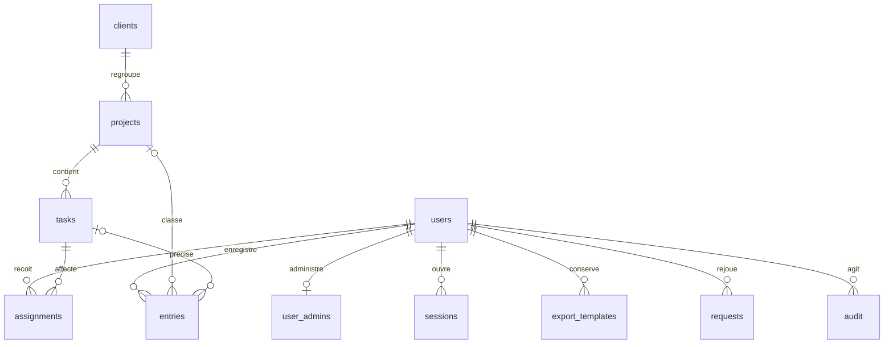

# Passage à PostgreSQL + Drizzle

Le serveur dispose maintenant d'un stockage **PostgreSQL + Drizzle asynchrone** et d'un import explicite des **13 tables SQLite**. `DATABASE_URL` sélectionne PostgreSQL ; sans cette variable, l'application conserve les fichiers SQLite existants via un adaptateur compatible. La migration se prépare et s'exécute sur le serveur : aucune installation PostgreSQL n'est nécessaire sur le PC.

Les principaux fichiers sont :

- `server/db/schema.ts` : les 13 tables, leurs clés, contraintes et index PostgreSQL.
- `drizzle/0000_initial_postgresql.sql` : migration générée des 13 tables, contraintes et index.
- `drizzle/0001_journal_guards.sql` : migration SQL personnalisée protégeant `audit` et `event_log` contre `UPDATE`, `DELETE` et `TRUNCATE`, puis contrôlant la continuité de `seq` et de `previous_hash` à l'insertion.
- `server/db/postgres.mjs` : pool `pg`, requêtes paramétrées Drizzle, transactions, conversions et migrations explicites.
- `server/db/journal.mjs` : initialisation, écriture, audit et vérification asynchrones du journal PostgreSQL.
- `server/db/sqlite-import-source.mjs` : copie cohérente en lecture seule, contrôle de la source et empreintes des 13 tables.
- `server/db/import-sqlite.mjs` et `scripts/import-sqlite.mjs` : import atomique, vérification de la cible et commande `pnpm db:import`.
- `server/async-store.mjs` : sélection du stockage, méthodes métier, instantanés et données de démonstration.
- `tsconfig.db.json` : vérification TypeScript du schéma et de la configuration Drizzle, incluse dans `pnpm typecheck`.

La migration réelle et la bascule vers `2026.11.17-postgres-1` sont terminées. L'audit en lecture seule du **17 novembre 2026** confirme l'égalité des 13 tables à l'import, la présence de tous les utilisateurs et temps d'origine, les audits exacts et le préfixe du journal, ainsi que le checkpoint conservé séparément. Les empreintes des sauvegardes SQLite et PostgreSQL sont vérifiées. La restauration d'essai et une sonde native de concurrence ont réussi avant publication. La planification, la rétention et la copie séparée des sauvegardes restent des points d'exploitation à vérifier.

## Schéma cible

Les noms de tables et de colonnes restent en `snake_case`, comme dans la base actuelle.

| Table | Rôle et relations principales |
| --- | --- |
| `meta` | Valeurs globales : révision, début du suivi, version du journal. Clé `key`. |
| `users` | Comptes, mot de passe déjà hashé, rôle de base, activation, couleur et préférences. |
| `user_admins` | Élévation administrateur ; une ligne par compte administrateur, liée à `users`. |
| `sessions` | Hash du token de session, compte, CSRF et expiration. |
| `clients` | Clients partagés ; référence au compte créateur. |
| `projects` | Projets d'un client ; couleur, description, archivage et version. |
| `tasks` | Tâches d'un projet ; statut `todo`/`doing`/`done`, description, archivage et version. |
| `assignments` | Association tâches/personnes, clé composée `(task_id, user_id)`. |
| `entries` | Temps d'une personne, avec projet et tâche facultatifs, horaires, version et suppression logique. |
| `audit` | Historique métier avant/après, acteur et propriétaire éventuel. |
| `requests` | Idempotence : clé composée `(user_id, key)`, empreinte de la requête et réponse mémorisée. |
| `export_templates` | Modèles personnels d'export, configuration, version et dates. |
| `event_log` | Journal chaîné : numéro contigu, événement, contenu exact, empreinte précédente et empreinte courante. |



Le diagramme montre les relations principales ; les références aux créateurs et au propriétaire d'un historique sont également dans le schéma. `event_log.actor` reste une référence informative sans clé étrangère, comme dans SQLite.

## Choix de compatibilité

| Donnée | Stockage PostgreSQL | Compatibilité de l'application |
| --- | --- | --- |
| Identifiants | `text` | Conserver les UUID existants et les identifiants de démonstration tels que `demo-alex` ; aucune renumérotation. |
| Dates, expirations, révision et séquence du journal | `bigint` | L'adaptateur restitue des nombres JavaScript et refuse les entiers hors plage sûre. Les dates restent en millisecondes Unix. |
| `active`, `archived`, `deleted` | `boolean` | L'import convertit strictement les `0`/`1` SQLite en booléens PostgreSQL ; l'adaptateur restitue des `0`/`1` au code métier et à l'API. |
| `users.preferences`, `requests.result`, `export_templates.config` | `jsonb` | L'adaptateur restitue du JSON texte au code métier, qui conserve ses `JSON.parse`/`JSON.stringify`. L'API reçoit les objets décodés. Ces champs ne sont pas des textes signés. |
| `audit.before_json`, `audit.after_json`, `event_log.details_json` | `text` | Copier les chaînes **à l'identique**. Leur représentation fait partie de la vérification du journal. Aucun passage par JSONB ni reformatage à l'import. |
| Rôles | `users.role` + `user_admins` | Garder `member`/`manager` dans `users`, puis calculer le rôle public `admin` à partir de `user_admins`. |

Les index d'unicité des identifiants, des noms de clients et des noms de projets par client utilisent une expression `translate` de A–Z vers a–z. Elle reproduit le comportement ASCII de `COLLATE NOCASE` utilisé actuellement. `findUserByUsername` utilise la même expression pour les connexions, la gestion des comptes et la récupération. L'éventuelle normalisation Unicode est une évolution séparée, avec détection préalable des collisions.

L'index unique partiel de `entries` autorise au plus un chrono non supprimé, sans fin, par personne. La contrainte `end IS NULL OR end >= start` reste en place. Aucun index d'exclusion des chevauchements n'est ajouté : l'application permet de confirmer volontairement un chevauchement.

Les clés étrangères empêchent les suppressions qui laisseraient des références invalides. Seule la suppression d'une tâche supprime automatiquement ses lignes `assignments`. La suppression métier d'un client, projet ou tâche doit toujours désaffecter et auditer les temps avant de retirer le catalogue ; les temps ne sont jamais supprimés par cascade. Le retrait d'un compte reste une désactivation.

## Importer sur le serveur

Toutes les commandes de cette section s'exécutent dans le répertoire de TimeTeknika **sur le serveur**, depuis une session SSH ou dans son conteneur applicatif. Les chemins montrés sont des exemples de chemins serveur ; ils doivent désigner la base de production et une nouvelle sauvegarde conservée sur ce serveur. Ne pas recopier une base de démonstration du PC à la place des données utilisées par l'équipe.

La cible PostgreSQL doit être une base dédiée **migrée et entièrement vide**. Il faut importer avant le premier démarrage de l'application PostgreSQL : un démarrage sur une base vide crée déjà `meta` et `journal-enabled`, et cette cible initialisée sera ensuite refusée par l'importeur. L'importeur ne supprime ni ne fusionne une cible occupée.

Ordre de la bascule :

1. Arrêter les écritures de l'application SQLite sur le serveur et conserver l'ancienne version disponible pour une reprise contrôlée.
2. Produire une sauvegarde SQLite cohérente avec l'API de sauvegarde et conserver ce fichier après la migration. La copie temporaire interne à l'importeur n'est pas cette sauvegarde durable.
3. Préparer la base PostgreSQL dédiée et configurer `DATABASE_URL` côté serveur. Conserver les valeurs existantes de `APP_URL`, `SETUP_TOKEN` et des autres réglages.
4. Appliquer les migrations de structure, contrôler la source puis la source et la cible, et effectuer l'import.
5. Vérifier le journal et le rapport d'import, puis démarrer l'application PostgreSQL. Vérifier les connexions des comptes existants, les temps, les chronos et les exports avant de rendre le service aux utilisateurs.

Exemple pour un environnement serveur où Node.js et pnpm sont déjà disponibles, une fois les écritures SQLite arrêtées et `DATABASE_URL` configurée :

```bash
node scripts/backup.mjs data/teknika.sqlite data/backups/avant-postgresql.sqlite
pnpm db:migrate
pnpm db:import --source data/backups/avant-postgresql.sqlite --check-source
pnpm db:import --source data/backups/avant-postgresql.sqlite --dry-run
pnpm db:import --source data/backups/avant-postgresql.sqlite
pnpm db:verify
# Seulement après le succès des contrôles précédents :
pnpm start
```

Avec Docker, ces commandes utilisent les mêmes scripts dans l'image applicative et les chemins montés dans le conteneur. Les commandes `pnpm` ne nécessitent pas d'installation sur le PC. La procédure automatisée `scripts/deploy-postgres.sh` et la configuration `deploy/compose.postgres.yaml` ont été exécutées pour la version `2026.11.17-postgres-1`. L'essai d'import, la sonde de concurrence et la restauration PostgreSQL sur des bases isolées ont réussi avant l'arrêt du service SQLite, puis la sauvegarde finale, l'import et les contrôles ont précédé la publication. Le simple ajout de l'importeur ne déclenche pas cette procédure.

Les options de `pnpm db:import` sont :

| Option | Effet |
| --- | --- |
| `--source CHEMIN.sqlite` | Source explicite obligatoire ; utiliser la sauvegarde finale du serveur. |
| `--check-source` | Contrôle SQLite uniquement, sans connexion PostgreSQL. |
| `--dry-run` | Contrôle la source et la cible PostgreSQL sans copier de lignes. |
| `--checkpoint CHEMIN.json` | Compare également le journal source à un checkpoint conservé séparément. |
| `--demo` | Cible `DEMO_DATABASE_URL`, uniquement pour une base de démonstration séparée. |

La source est ouverte en lecture seule, puis copiée de manière cohérente dans un dossier temporaire privé. L'import vérifie les 13 tables actuelles, les clés, références, doublons, valeurs, JSON et l'intégrité du journal avant d'ouvrir la cible. Les schémas anciens ou contenant des tables/colonnes inconnues sont refusés explicitement ; aucune donnée inconnue n'est ignorée. Les nombres ou textes non représentables sans perte dans PostgreSQL sont également refusés.

Le déploiement prépare ses copies figées `trial.sqlite` et `final.sqlite` avec `scripts/prepare-sqlite-backup.py` avant de les monter en lecture seule. L'API de sauvegarde SQLite conserve le mode WAL, qui peut encore nécessiter la création de fichiers annexes lors d'une lecture. L'utilitaire passe uniquement ces copies privées en mode `DELETE`, contrôle leur intégrité et ferme la connexion ; la base active n'est pas modifiée. Les quatre régressions `python3 tests/test_sqlite_backup.py` ont été exécutées sur Linux sans privilèges : reproduction de l'échec avec un répertoire non inscriptible, lecture réussie après préparation, conservation des données du WAL et du checkpoint, refus des fichiers invalides et des liens. L'importeur conserve son accès en lecture seule. Les erreurs d'import indiquent désormais les codes système/SQLite reconnus sans afficher les paramètres ou données privées.

Les utilisateurs, identifiants, hashes de mots de passe, administrateurs, sessions, clients, projets, tâches, affectations, temps, versions, modèles, réponses idempotentes et métadonnées gardent leurs valeurs. Les temps supprimés logiquement et les chronos en cours sont inclus. Les chaînes de `audit.before_json`, `audit.after_json` et `event_log.details_json`, ainsi que les numéros et empreintes du journal, restent exactes. Seuls les champs JSONB sont comparés sous une forme sémantique canonique, et les indicateurs `0`/`1` sont convertis en booléens.

Toutes les insertions et leur vérification s'exécutent dans une seule transaction PostgreSQL, sous les verrous applicatif et des tables. Avant commit, l'import compare les effectifs et empreintes de chaque table ainsi que le checkpoint complet du journal. Une différence annule l'import. Aucun événement d'import n'est ajouté au journal afin de conserver le checkpoint original à l'identique ; le démarrage ultérieur de l'application ajoutera normalement son événement `server-start`.

Le rapport JSON contient les effectifs, empreintes et un résumé des temps, sans les mots de passe, cookies, jetons de session ou descriptions. Les résultats possibles sont `source-validated`, `validated`, `imported` et `already-imported`. Un rejeu sur une cible encore exactement identique est reconnu sans réinsérer de lignes. Si la cible contient d'autres données, y compris un journal initialisé ou de nouvelles écritures après démarrage, l'import est refusé. Après une coupure dont le résultat est incertain, relancer d'abord la validation sur la même sauvegarde : la cible doit être vide ou exactement identique. Ne pas vider une cible occupée pour contourner le refus.

L'import ne synchronise pas les écritures SQLite qui surviendraient après sa copie cohérente. L'application SQLite doit donc rester arrêtée depuis la sauvegarde finale jusqu'à la validation de la bascule. Après la reprise des écritures sur PostgreSQL, revenir simplement à l'ancien fichier SQLite perdrait les nouvelles saisies ; une reprise à ce stade exige une procédure de rapprochement distincte. Conserver la sauvegarde et les rapports de contrôle sur le serveur et sur un emplacement de sauvegarde séparé.

## Démarrage, configuration et démonstration

`pnpm db:migrate` applique uniquement les migrations de structure. Le démarrage normal vérifie les tables, l'historique et les empreintes des migrations, ainsi que les triggers requis. Il initialise les métadonnées et `journal-enabled` uniquement dans une base migrée entièrement vide ; sinon il vérifie la chaîne existante. Une base partiellement importée ou un journal altéré provoque un refus de démarrage, sans réparation automatique. Les fichiers de migration SQL et leurs métadonnées restent en LF via `.gitattributes` pour stabiliser les empreintes entre plateformes.

`pnpm start`, `pnpm demo`, `pnpm dev`, `pnpm dev:real`, `pnpm db:migrate`, `pnpm db:import`, `pnpm db:verify` et `pnpm backup` chargent `.env` s'il existe. Une commande `node` lancée directement doit recevoir les variables dans son environnement ou utiliser `--env-file-if-exists=.env`. Pour un espace PostgreSQL neuf sans données à reprendre, `pnpm db:migrate` puis `pnpm start` restent le parcours d'initialisation ; ce parcours ne remplace pas l'import ci-dessus.

Une démonstration PostgreSQL doit utiliser **une autre base** dans `DEMO_DATABASE_URL`. `pnpm db:migrate --demo` prépare son schéma ; `pnpm demo` la remplit uniquement si elle ne contient aucun utilisateur. Pour y reprendre une sauvegarde de démonstration, exécuter `pnpm db:import --source CHEMIN.sqlite --demo` avant ce premier démarrage. Le serveur de démonstration ignore `DATABASE_URL`. Sans `DEMO_DATABASE_URL`, il conserve SQLite. Les lanceurs Windows historiques restent des aperçus SQLite séparés ; ils ne déploient pas PostgreSQL sur le serveur.

## Transactions et arrêt du serveur

Les routes HTTP, l'authentification, les sessions, les mutations, les aperçus, les exports, les notifications SSE, le heartbeat et la fermeture attendent leurs accès aux données. Le pilote `pg` utilise un pool limité avec délais de connexion et d'exécution. Les requêtes passent par les paramètres liés de Drizzle ; les valeurs reçues ne sont pas concaténées au SQL.

Les mutations PostgreSQL prennent le verrou transactionnel global `pg_advisory_xact_lock(1414808906, 1)` avant leurs lectures métier. Ce choix conserve la sérialisation des écritures assurée auparavant par SQLite, y compris pour la révision, l'idempotence, le dernier administrateur et le journal. Il privilégie cette compatibilité avant une optimisation des écritures simultanées. Les écritures utilisent `READ COMMITTED`, les lectures cohérentes `REPEATABLE READ` en lecture seule, et une transaction conserve sa connexion jusqu'au commit ou rollback. Les transactions imbriquées utilisent des savepoints.

La session et les droits sont revérifiés dans la transaction avant la mutation. Une session révoquée pendant l'attente ne peut donc plus écrire. Les notifications sont publiées après commit. La fermeture refuse les nouveaux travaux, termine les flux SSE, attend les opérations et journaux en cours, ajoute `server-stop`, puis ferme le stockage. L'adaptateur SQLite sérialise également les opérations asynchrones pour éviter qu'une autre requête ne rejoigne une transaction suspendue à un `await`.

## Vérification et commandes de développement

```bash
pnpm db:generate
pnpm db:check
pnpm typecheck
pnpm test:db
pnpm test
```

`db:generate` produit le SQL à partir du schéma ; `db:check` contrôle la cohérence de l'historique des migrations. La génération sans différence, `pnpm db:check`, `pnpm typecheck` et `pnpm build` ont été exécutés avec succès. `pnpm typecheck` vérifie aussi les fichiers de base de données. La suite complète exécutée avant livraison comptait **159 tests réussis**, auxquels s'ajoutaient **2 tests UI réussis**. Les validations ciblées ultérieures ont également réussi : **5 tests CLI, 3 tests d'audit et 4 tests Linux de préparation des sauvegardes**.

`test:db` exécute les suites `postgres-*.test.mjs` avec des bases éphémères PGlite. Les tests HTTP utilisent le serveur complet et le véritable adaptateur PostgreSQL/Drizzle : comptes, droits, catalogue, chronos, idempotence, versions, préférences, rapports, exports CSV/Excel/PDF, SSE, rollback et fermeture. Ils comprennent une révocation entre l'authentification initiale et la transaction, ainsi qu'une configuration vierge concurrente. Les tests de cycle de vie couvrent aussi une connexion SSE en cours pendant l'arrêt et la fermeture de l'adaptateur SQLite ; les tests historiques restent dans la régression générale. Les tests d'import ajoutent la comparaison des données et du journal avant/après copie, les refus des sources ou cibles incompatibles et la reprise sans duplication.

PGlite exécute PostgreSQL dans le processus et utilise une connexion. La recette serveur a ajouté une sonde de douze incréments transactionnels et ajouts au journal, répartis entre deux pools natifs `pg`, avec vérification du résultat et du journal. Le déploiement, l'import et la restauration sont validés sur PostgreSQL natif. Cette sonde ne couvre pas tous les scénarios métier concurrents ; les pannes du pool, les interruptions réseau et les performances restent à tester.

Pour vérifier un journal PostgreSQL existant, sans l'initialiser :

```bash
pnpm db:verify
# Comparaison facultative avec un checkpoint conservé séparément :
pnpm db:verify chemin/vers/checkpoint.json
```

Cette commande équivaut à `node --env-file-if-exists=.env scripts/verify-journal.mjs --postgres` et nécessite `DATABASE_URL`. La récupération par `scripts/reset-password.mjs` utilise également `DATABASE_URL` lorsqu'elle est présente, révoque les sessions et écrit l'audit dans la même transaction ; le nouveau mot de passe reste lu sur stdin. Sans URL, la récupération conserve son fonctionnement SQLite. Pour vérifier SQLite, appeler directement `scripts/verify-journal.mjs` avec le chemin du fichier, sans `--postgres`.

`pnpm backup` reste un outil SQLite. Si `DATABASE_URL` est configurée et qu'aucun fichier source explicite n'est fourni, il refuse de sauvegarder par erreur le fichier SQLite par défaut. Après migration, `sudo bash scripts/backup-linux.sh` sélectionne `scripts/backup-postgres.sh`. Ce dernier crée une archive `pg_dump`, contrôle sa liste avec `pg_restore --list` et conserve son empreinte SHA-256 dans `/var/backups/timeteknika`, avec des permissions privées. La procédure de déploiement a également restauré une archive sur une base PostgreSQL isolée et comparé les données au jeu d'essai importé. L'audit final confirme les empreintes des sauvegardes conservées.

Après la migration, exécuter les commandes d'exploitation depuis le répertoire applicatif **sur le serveur**, avec les deux fichiers de configuration :

```bash
sudo docker compose --env-file .env --env-file .env.postgres ps
sudo docker compose --env-file .env --env-file .env.postgres logs --tail=80 teknika
sudo docker compose --env-file .env --env-file .env.postgres exec -T teknika node scripts/verify-journal.mjs --postgres
sudo bash scripts/backup-linux.sh
```

`.env.postgres` appartient à root en mode `600` et conserve le nom du projet Compose, l'image validée et les identifiants générés sur le serveur. Préserver ces permissions ; ne pas afficher ni publier ses secrets. Le rôle applicatif reste distinct du rôle de migration, sans privilèges superutilisateur ni propriété des tables d'historique. Conserver cette séparation lors des interventions. La configuration complémentaire est installée en `compose.override.yaml` ; les commandes Compose sans les deux fichiers d'environnement échouent faute de configuration privée.

Le schéma TypeScript est la source des tables et index. Les fonctions et triggers propres au journal doivent être conservés dans une migration SQL personnalisée distincte, afin de ne pas perdre ces protections lors des évolutions suivantes. Drizzle documente la [déclaration de schéma](https://orm.drizzle.team/docs/sql-schema-declaration), les [contraintes et index](https://orm.drizzle.team/docs/indexes-constraints), la [configuration des migrations](https://orm.drizzle.team/docs/drizzle-config-file) et les [migrations SQL personnalisées](https://orm.drizzle.team/docs/kit-custom-migrations).

## Avancement et étapes suivantes

### 1. Valider le schéma et les migrations

- [x] Générer les 13 tables, contraintes et index dans `0000_initial_postgresql.sql`, puis vérifier l'absence de différence avec le schéma et la cohérence de l'historique Drizzle.
- [x] Vérifier les types du schéma et de la configuration via `pnpm typecheck`.
- [x] Exécuter les migrations sur PGlite et vérifier leur suivi de version ainsi que leur rejeu sans modification.
- [x] Exécuter les migrations sur PostgreSQL natif et vérifier une sonde de douze opérations concurrentes avec deux pools `pg`.
- [x] Vérifier l'unicité des noms, les références, les valeurs par défaut, les statuts et l'index du chrono actif avec des insertions valides et invalides.
- [x] Porter les protections du journal dans `0001_journal_guards.sql` : refus de modification, suppression et `TRUNCATE` de `audit`/`event_log`, contrôle de la continuité de `seq` et de `previous_hash`. PostgreSQL permet des [triggers par ligne ou par instruction](https://www.postgresql.org/docs/current/sql-createtrigger.html), notamment pour `TRUNCATE`.
- [x] Vérifier le refus d'une chaîne invalide et le rollback d'une écriture métier lorsque son journal échoue.

### 2. Brancher une couche de stockage asynchrone

- [x] Installer `drizzle-orm` et le pilote PostgreSQL `pg`.
- [x] Créer le pool, une configuration explicite de connexion, les délais d'attente et la fermeture propre du pool.
- [x] Brancher `server/index.mjs`, `server/admin-role.mjs` et `server/catalog-delete.mjs` sur une interface asynchrone ; garder `server/store.mjs` pour la compatibilité SQLite et les outils existants.
- [x] Rendre asynchrones le démarrage, les sessions, les instantanés, les mutations, la publication SSE, le heartbeat et l'arrêt du serveur ; chaque transaction conserve sa connexion jusqu'au commit/rollback.
- [x] Centraliser les conversions du tableau ci-dessus pour préserver le contrat de l'API, y compris les données des exports et les réponses d'idempotence.
- [x] Traiter les codes PostgreSQL et les noms de contraintes, notamment `23505`, `one_running_per_user` et `users_username_nocase`, en conservant la compatibilité avec les erreurs SQLite.

### 3. Préserver les garanties de concurrence

Le verrou PostgreSQL commun aux mutations et au journal remplace la sérialisation des écritures SQLite. Les garanties suivantes sont implémentées et couvertes par les tests HTTP avec PGlite, dont plusieurs scénarios de requêtes parallèles. La sonde native valide les incréments et ajouts au journal entre deux pools ; la recette native complète des scénarios métier reste distincte.

- [x] Assurer l'idempotence de `(user_id, key)` dans la transaction sérialisée : une seule mutation, même réponse mémorisée, conflit si le contenu diffère.
- [x] Vérifier les versions puis écrire sous le même verrou et dans la même transaction ; rejeter les versions obsolètes.
- [x] Protéger démarrage/arrêt/remplacement du chrono, archivage, affectations et suppression de catalogue dans les transactions de mutation.
- [x] Protéger la création du premier compte, le dernier administrateur actif et la fusion des préférences ; revérifier session et droits après la prise du verrou.
- [x] Enregistrer révision, mutation, audit, journal et résultat d'idempotence dans la même transaction ; notifier les clients après le commit.

### 4. Porter le journal sans casser les empreintes

- [x] Ajouter `server/db/journal.mjs` avec opérations asynchrones et savepoints ; conserver `server/journal.mjs` pour SQLite.
- [x] Prendre `pg_advisory_xact_lock(1414808906, 1)` **avant de lire la tête du journal**, puis calculer `seq`, `previous_hash` et le hash sur cette connexion. Les événements techniques suivent le même protocole que les audits métier.
- [x] Garder une séquence manuelle contiguë, réutilisable après rollback ; vérifier aussi la continuité via le trigger `event_log_chain`.
- [x] Vérifier le journal et ses audits sur un instantané cohérent, avec lecture par lots.
- [x] Accepter les checkpoints externes et refuser un historique incohérent, sans recalcul ni réparation automatique de la chaîne.
- [x] Initialiser transactionnellement une base migrée vide : `meta` et `journal-enabled`. Refuser l'initialisation d'une base contenant déjà des données sans marqueur valide.

### 5. Importer SQLite sur une copie

- [x] Ajouter une copie cohérente en lecture seule et le contrôle de son journal avant toute ouverture de la cible.
- [x] Précontrôler tables, références, doublons, JSON, valeurs numériques et contraintes avant les insertions PostgreSQL.
- [x] Importer les 13 tables dans l'ordre des dépendances, avec les mêmes IDs, hashes de mots de passe, sessions, versions, dates et contenus du journal ; importer `event_log` dans l'ordre de `seq`.
- [x] Préserver `meta`, notamment `balance_start`, `revision` et `journal_version`, sans initialiser une nouvelle chaîne ni ajouter un événement d'import.
- [x] Comparer les effectifs et empreintes de toutes les tables, puis le checkpoint complet du journal avant commit. Les affectations, temps, préférences et modèles d'export font partie de ces comparaisons.
- [x] Documenter la reprise sur une cible vide ou identique, le refus d'une cible différente et la limite du retour à SQLite après de nouvelles écritures PostgreSQL.
- [x] Arrêter les écritures réelles sur le serveur, produire et conserver la sauvegarde finale ainsi que son checkpoint.
- [x] Exécuter la validation et l'import sur le serveur, conserver les rapports, comparer les tables et vérifier les instantanés et exports applicatifs.
- [ ] Tester la procédure opérationnelle de retour arrière avant toute reprise des saisies sur PostgreSQL.

### 6. Adapter exploitation et livraison

- [x] Ajouter `DATABASE_URL`/`DEMO_DATABASE_URL`, les commandes explicites et les fichiers de migration aux images Docker et à la livraison.
- [x] Transmettre `DATABASE_URL` depuis `compose.yaml` pour une base PostgreSQL externe.
- [x] Revoir, valider et exécuter `scripts/deploy-postgres.sh` et `deploy/compose.postgres.yaml` sur le serveur, avec volume persistant et contrôle de disponibilité PostgreSQL.
- [x] Construire et tester les images Docker, exécuter les migrations et vérifier un démarrage réel contre PostgreSQL.
- [x] Prévoir des rôles séparés pour la migration et l'application, ainsi que des fichiers de configuration privés appartenant à root en mode `600`.
- [x] Vérifier les permissions et protections du journal avec le rôle applicatif sur PostgreSQL natif.
- [x] Ajouter `scripts/backup-postgres.sh` avec `pg_dump`, contrôle de la liste et empreinte, et le sélectionner depuis `scripts/backup-linux.sh` après migration.
- [x] Exécuter la recette automatique de restauration complète sur une base PostgreSQL isolée avant l'arrêt de production.
- [ ] Vérifier la planification, la rétention et la copie séparée des sauvegardes.
- [x] Porter `scripts/verify-journal.mjs --postgres` et `scripts/reset-password.mjs` ; empêcher une sauvegarde SQLite par défaut lorsqu'une URL PostgreSQL est configurée.
- [x] Valider sur le serveur la recette PostgreSQL de restauration ; `scripts/verify-restored-database.mjs` conserve son rôle historique pour SQLite.
- [x] Séparer les variables et commandes de développement/démonstration ; conserver les lanceurs Windows historiques sur SQLite.
- [x] Inclure `drizzle/`, ses métadonnées et la configuration dans les listes autorisées du packaging et de l'installateur.
- [x] Exécuter et valider la nouvelle procédure de déploiement PostgreSQL. L'installateur historique `scripts/install-update.sh` reste orienté SQLite.
- [ ] Tester un échec provoqué pour vérifier le retour arrière avant publication ; ce chemin n'a pas été exercé pendant la bascule réussie.

### 7. Recette avant bascule

- [x] Exécuter les tests HTTP, droits, catalogue, temps, journal, rapports et exports avec PostgreSQL via PGlite.
- [x] Tester rollback, échec du journal, révocation pendant une mutation en attente, notifications après commit et fermeture avec opérations en cours.
- [x] Réussir les 159 tests de la suite complète, les 2 tests UI, TypeScript, le build et le contrôle Drizzle.
- [ ] Tester avec plusieurs connexions les doubles clics/rejeux, les versions concurrentes, le chrono unique, les mutations de rôles et les append simultanés du journal.
- [ ] Tester les interruptions réseau, la reprise du pool natif et les performances avec les volumes réels.
- [ ] Comparer un jeu de données importé avec SQLite : totaux, exports, frontières de jours `Europe/Zurich`, journées de 23/25 heures et historique exact.
- [x] Effectuer la recette de restauration, puis la bascule de l'application et l'audit en lecture seule de conservation des données.

Le passage à PostgreSQL ne suffit pas à permettre plusieurs instances du serveur. Les abonnements SSE et le compteur des tentatives de connexion résident actuellement en mémoire dans `server/index.mjs`. La première bascule peut conserver une seule instance ; plusieurs instances nécessiteront une diffusion partagée des révisions/révocations et une limitation des tentatives partagée.

## Contrôle après la bascule

`scripts/audit-postgres-migration.sh` contrôle le serveur en lecture seule, avec les droits administratifs nécessaires pour lire les rapports privés. Il vérifie la version active, la configuration réelle du conteneur, les fichiers installés et le dossier de migration correspondant à la base active. Il lance ensuite `scripts/audit-postgres-migration.mjs` sur l'image applicative en cours, avec le compte PostgreSQL applicatif et des montages en lecture seule.

Le contrôle recalcule les empreintes de la sauvegarde SQLite et des 13 tables, les compare aux rapports d'import et vérifie les rapports de concurrence et de restauration. Sur un instantané cohérent de la base PostgreSQL actuelle, il vérifie le journal complet et son checkpoint d'origine, la présence de chaque ancien utilisateur et de chaque ancienne entrée de temps, ainsi que le contenu exact des audits d'origine. Il contrôle aussi les empreintes des sauvegardes conservées. Les compteurs à l'import et les compteurs actuels sont séparés : des modifications métier peuvent avoir eu lieu depuis le démarrage. Le total des millisecondes concerne les temps terminés non supprimés et exclut les chronos ouverts.

Un fichier facultatif `external-journal-checkpoint.json`, placé à côté du script shell, permet également de contrôler le compteur et l'empreinte d'un export de journal conservé séparément. Il contient seulement `count` et `hash`. Le rapport produit ne contient ni noms, descriptions, mots de passe, sessions, ni URL de connexion. Ce contrôle ne relance pas l'import et ne modifie aucune donnée PostgreSQL.
